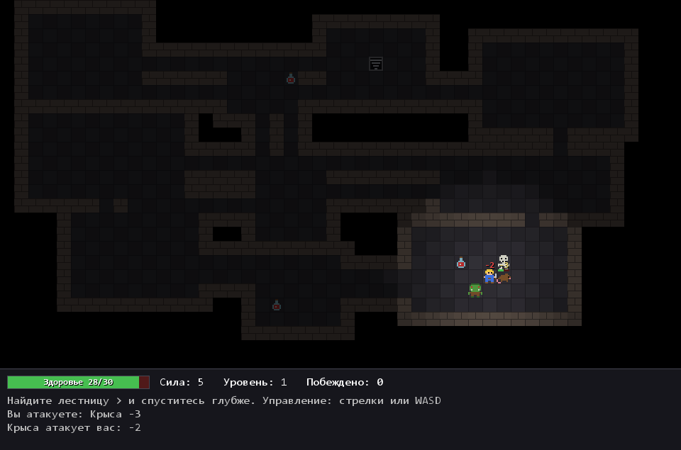

# Rogalic

Пошаговая игра-рогалик на Java. Герой спускается всё глубже в подземелье, сражается с монстрами и ищет лестницу вниз. Каждый уровень генерируется заново, а вся графика нарисована кодом — без картинок и сторонних библиотек.



## Возможности

- Случайное подземелье из комнат и коридоров на каждом уровне
- Пошаговый бой: чтобы атаковать, нужно шагнуть в клетку врага
- Три вида монстров — крыса, скелет и орк. Чем глубже, тем их больше и тем они сильнее
- Монстры замечают героя и идут к нему
- Зелья лечения и лестница на следующий уровень. После спуска герой становится сильнее
- Туман войны: видно только то, что рядом, а исследованные места остаются на карте
- Освещение вокруг героя
- Пиксельные спрайты 10×10, заданные строками прямо в коде
- Цифры урона, полоски здоровья и журнал событий

## Управление

| Клавиша | Действие |
|---|---|
| Стрелки или WASD | Шаг или атака |
| R или Enter | Начать заново после гибели |

## Запуск

Нужна JDK 24 или новее.

**В IntelliJ IDEA:** открыть папку проекта и запустить класс `Main`.

**Из терминала** в папке проекта:

```bash
javac -encoding UTF-8 -d target/classes -sourcepath src/main/java src/main/java/org/example/Main.java
java -cp target/classes org.example.Main
```

## Как устроен код

Все классы лежат в `src/main/java/org/example`.

| Класс | Что делает |
|---|---|
| `Main` | Создаёт окно игры |
| `GamePanel` | Рисует игру и обрабатывает клавиши |
| `Game` | Логика: ходы, бой, монстры, уровни |
| `Dungeon` | Генерирует карту подземелья |
| `Room` | Комната на карте |
| `Creature` | Существо: герой или монстр |
| `Hit` | Один удар — для цифр урона на экране |
| `Sprites` | Пиксельные рисунки и палитра цветов |

### Один ход

1. Игрок нажимает клавишу.
2. Герой шагает. Если в клетке враг — атакует, если стена — остаётся на месте.
3. Каждый монстр рядом с героем атакует, а остальные, кто его заметил, идут к нему.
4. Экран перерисовывается.

### Генерация подземелья

Карта сначала полностью заполнена стеной. Затем в случайных местах вырезаются прямоугольные комнаты, которые не пересекаются друг с другом. Каждая новая комната соединяется с предыдущей Г-образным коридором, поэтому до любой комнаты можно дойти. Герой появляется в первой комнате, лестница вниз — в последней.

### Спрайты

Каждый спрайт — это 10 строк по 10 символов. Буква обозначает цвет, точка — прозрачный пиксель:

```java
public static final String[] ORC = {
        "..dddddd..",
        ".dggggggd.",
        ".grggggrg.",
        ...
};
```

Чтобы перерисовать персонажа, достаточно поменять буквы в строках.

## Идеи для развития

- Поиск пути, чтобы монстры обходили стены
- Инвентарь, оружие и броня
- Сохранение рекорда
- Звуки
